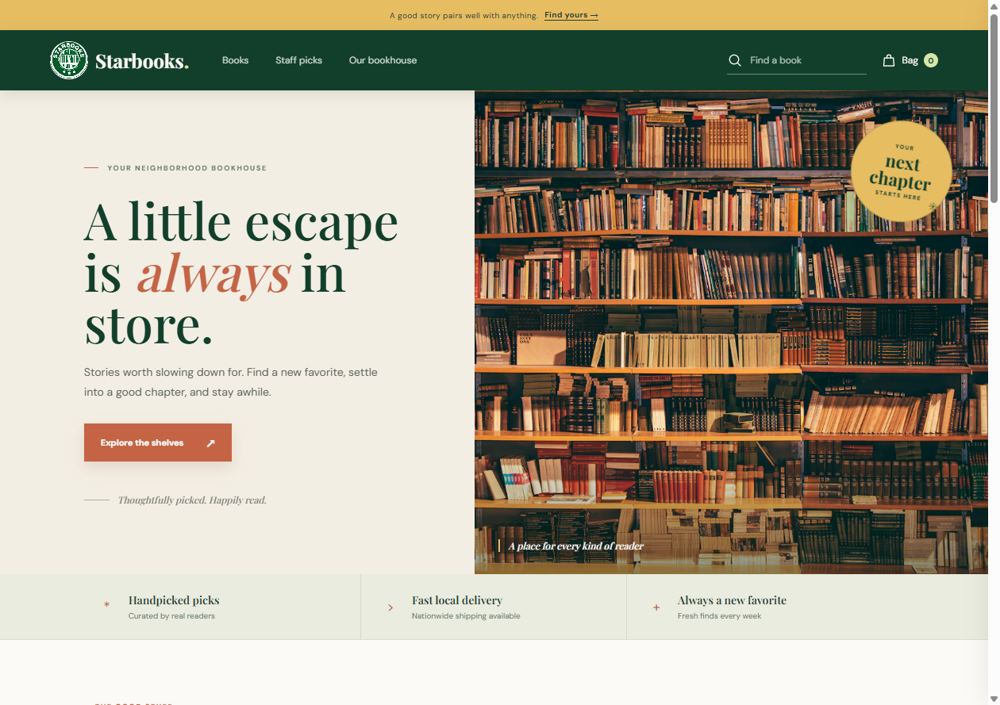
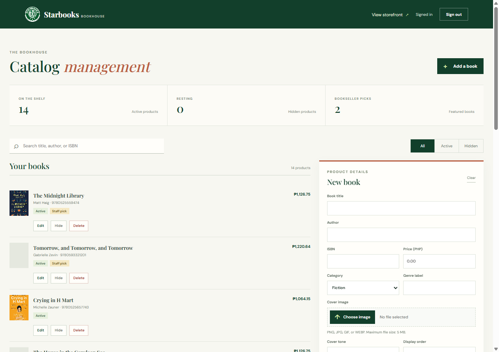
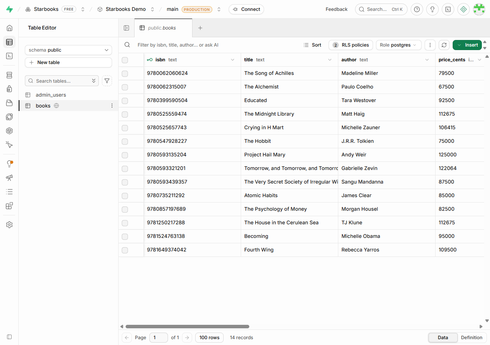
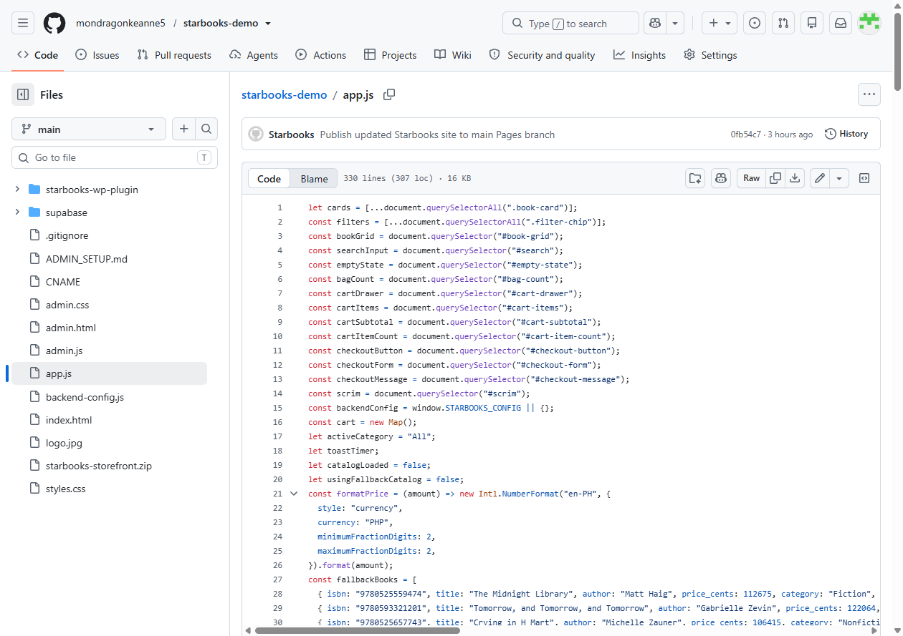
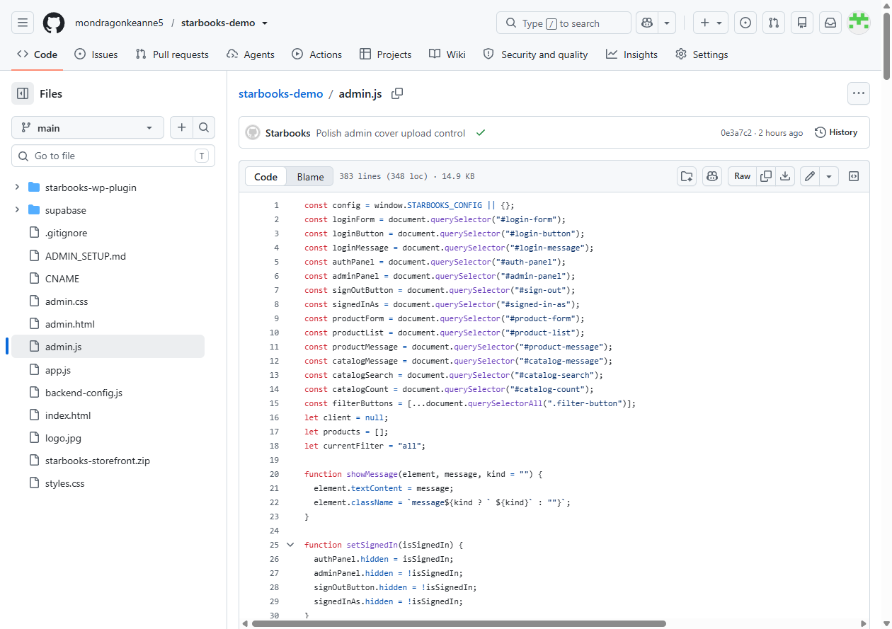
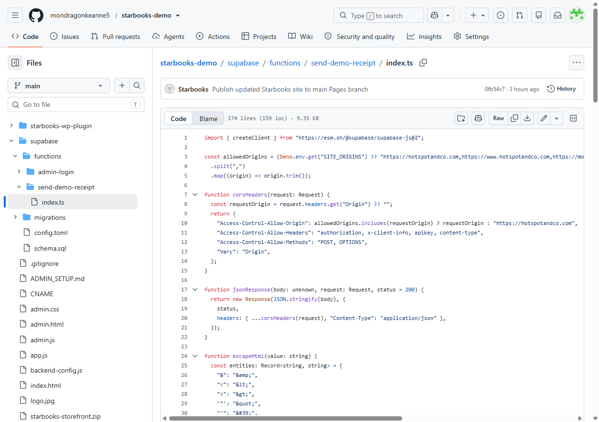
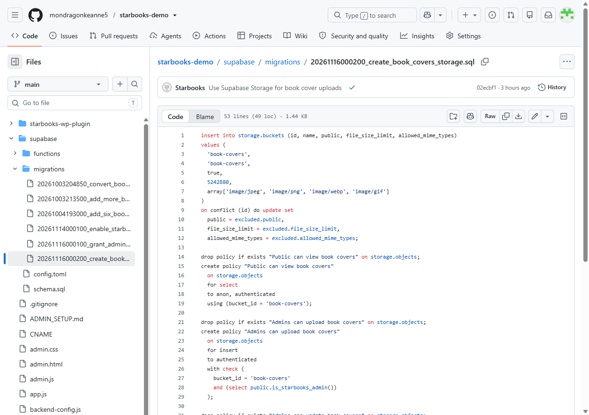

# Starbooks Bookhouse
## Project Documentation

**Project type:** Online bookstore and catalog administration
**Live storefront:** [hotspotandco.com](https://hotspotandco.com/)
**Catalog administration:** [hotspotandco.com/admin.html](https://hotspotandco.com/admin.html)
**Source repository:** [mondragonkeanne5/starbooks-demo](https://github.com/mondragonkeanne5/starbooks-demo)
**Documentation date:** November 2026

## 1. Project Overview

Starbooks is a lightweight bookstore website. Visitors can browse the active catalog, search and filter books, and add titles to a shopping bag. Authorized administrators manage the catalog through a separate dashboard.

The site is a static HTML, CSS, and JavaScript application hosted by GitHub Pages. Supabase provides the catalog database, administrator authentication, and cover-image storage.

## 2. User Interface

### 2.1 Storefront

The storefront presents the book collection, book details, search and genre filters, and a shopping bag.

*Figure 1. Live Starbooks storefront, desktop view.*

### 2.2 Catalog Administration

The administrator dashboard supports catalog search, product creation and editing, visibility controls, and book-cover uploads. Access requires an authorized administrator account.

*Figure 2. Live catalog administration dashboard. The capture contains no credentials.*

### 2.3 Supabase Catalog

The `public.books` table stores the active product catalog and is managed through Supabase Table Editor.

*Figure 3. Supabase Table Editor showing catalog records. Prices are stored as cents.*

## 3. Main Features

- Browse active books and search by title, author, or ISBN.
- Filter books by category and staff-pick status.
- Add catalog entries with ISBN, title, author, category, genre, price, cover, and display order.
- Upload JPEG, PNG, WEBP, or GIF cover images up to 5 MB to Supabase Storage.
- Edit catalog details and publish or hide a book.
- Send a checkout receipt by email through the Supabase Edge Function.

## 4. System Architecture

| Component | Purpose | Source location |
| --- | --- | --- |
| Public storefront | Renders the catalog and shopping bag | `index.html`, `styles.css`, `app.js` |
| Admin dashboard | Authenticates administrators and manages books | `admin.html`, `admin.css`, `admin.js` |
| Browser configuration | Supplies the Supabase project URL and public anon key | `backend-config.js` |
| Catalog database | Stores books and authorized administrator mappings | Supabase `public.books`, `public.admin_users` |
| Admin login function | Resolves username login and establishes an Auth session | `supabase/functions/admin-login/` |
| Receipt function | Validates checkout items and sends an email receipt | `supabase/functions/send-demo-receipt/` |
| Database changes | Defines access rules and Storage setup | `supabase/migrations/` |

## 5. Database and Storage

### 5.1 Database Tables

- **`public.books`** stores ISBN, title, author, price in cents, category, genre label, cover URL, cover tone, staff-pick state, active state, and sort order.
- **`public.admin_users`** maps Supabase Auth users to the usernames permitted to manage the catalog.

The current schema does **not** contain an orders table.

### 5.2 Cover Images

Book-cover files are uploaded to the public Supabase Storage bucket named `book-covers`. The database stores each image's public URL in `books.cover_url`. Public visitors can read covers; uploads and file management are restricted to authenticated Starbooks administrators. The bucket accepts JPEG, PNG, WEBP, and GIF files up to 5 MB.

### 5.3 Security

Public access is limited to reading active books and public cover images. Catalog writes require an authenticated account authorized in `public.admin_users`, enforced by Supabase Row Level Security. The repository must not contain passwords, service-role keys, or email-provider secrets.

## 6. Checkout Behavior

Checkout validates the requested ISBNs and quantities against the active Supabase catalog, then sends a receipt email through `send-demo-receipt`. It does not process a payment and does not save an order record. An order-history or live-orders dashboard would require adding persistent order storage separately.

## 7. Deployment

GitHub Pages publishes the repository root from the `main` branch. The custom domain is `hotspotandco.com`. Updates pushed to `main` trigger a Pages build and deployment.

The repository also contains a separate WordPress plugin package. It is not part of the current GitHub Pages site.

## 8. Administrator Setup

Follow [ADMIN_SETUP.md](../ADMIN_SETUP.md) to create and authorize administrator accounts and configure Supabase Auth URLs. Apply the migrations in `supabase/migrations/` and deploy the required Edge Functions before using the admin dashboard.

## 9. Important Limitations

- The storefront does not accept or process payments.
- Checkout sends a receipt email but does not persist orders.
- There is no live order feed in the admin dashboard because orders are not currently stored.
- The `admin_users` table is for authorization mappings; administrator passwords remain managed by Supabase Auth.

## 10. Source Code Appendix

The screenshots below show the relevant source files on GitHub. Use the linked file paths to view the complete code; the screenshots are representative excerpts, not full-file captures.

### 10.1 Storefront behavior

[`app.js`](https://github.com/mondragonkeanne5/starbooks-demo/blob/main/app.js) handles catalog loading, search and filtering, the shopping bag, and receipt checkout.

*Figure 4. Storefront JavaScript in the GitHub repository.*

### 10.2 Catalog administration

[`admin.js`](https://github.com/mondragonkeanne5/starbooks-demo/blob/main/admin.js) handles administrator sign-in, catalog queries, product editing, and cover uploads.

*Figure 5. Admin dashboard JavaScript in the GitHub repository.*

### 10.3 Receipt processing

[`send-demo-receipt/index.ts`](https://github.com/mondragonkeanne5/starbooks-demo/blob/main/supabase/functions/send-demo-receipt/index.ts) validates requested books and quantities against the active catalog before emailing a receipt.

*Figure 6. Supabase receipt Edge Function in the GitHub repository.*

### 10.4 Cover Storage configuration

[`20261116000200_create_book_covers_storage.sql`](https://github.com/mondragonkeanne5/starbooks-demo/blob/main/supabase/migrations/20261116000200_create_book_covers_storage.sql) configures the public cover bucket and restricts file changes to authorized administrators.

*Figure 7. Supabase Storage bucket and access-policy migration.*
